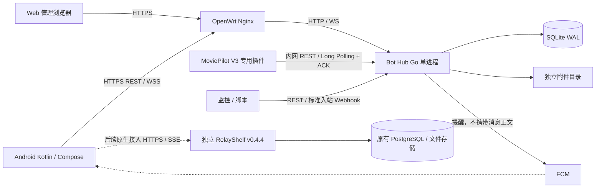

# RelayNest 系统架构

> 日期：2026-10-21；阶段：开发前设计，尚无实现或运行验证。  
> 依据：`PRD.md` v1.0，以及用户在 2026-10-21 对需求审查问题的明确答复。  
> 详细契约见 `TECHNICAL_DESIGN.md`；实施顺序与验收门槛见 `DEVELOPMENT_PLAN.md`。

## 1. 需求基线与已确认调整

PRD 是产品需求来源。本文件不修改 PRD；下表记录用户在本轮澄清中明确授权的补充和范围调整。后续编码必须同时阅读本节，不能仅依据旧 PRD 重新恢复已延期范围。

| 决策 | 确认结果 | 对 PRD 的影响 |
| --- | --- | --- |
| C-01 RelayShelf 基线 | 固定 v0.4.4 | 补充 §5 的外部兼容版本 |
| C-02 管理员 | 部署侧建立唯一管理员；容器内管理命令离线重置密码 | 补充 §3.1、§4.4；不开放注册 |
| C-03 编辑权限 | 接入应用编辑自身消息；Android 同步展示，首版不编辑已发送消息 | 明确 §3.2、§4.1 |
| C-04 失败队列 | Android 和 Web 均提供管理入口；Web 仅呈现脱敏投递元数据和重试操作 | 补充 §3.3，保留 Web 不浏览历史的边界 |
| C-05 发布优先级 | 优先核心消息平台；RelayShelf 原生接入优先级最低，可不进入首版 | 明确替代 §5、AC-11 的首版强制覆盖；双后端登录相关 AC-10 随接入延期 |

本计划据 C-05 将 RelayShelf 接入安排在核心版发布后；这是延期，不是取消完整原生覆盖目标。核心版仅需 Bot Hub 登录，不要求填写 RelayShelf 地址或等待其可用。未来启用 RelayShelf 时，保留单一账号密码输入入口、独立会话、TOTP 和部分登录状态；不合并身份系统。

**核心版交付范围**：Bot Hub、内嵌 Web 管理、Android Bot 对话/管理/通知/多设备、MoviePilot 专用插件、fnOS Compose 和 GitHub Actions。MoviePilot 仍为首个核心集成，未经确认不能因兼容性风险静默降级为单向通知。技术 PoC 是开发门槛，当前不代表获准开始业务编码。

## 2. 组件与职责



| 模块 | 拥有的职责 | 边界 |
| --- | --- | --- |
| Android | 原生界面、客户端会话、本地缓存、同步、通知、设备设置 | 不以 WebView 实现 RelayShelf 业务；不内置 MoviePilot 业务命令解析 |
| Bot Hub | Bot 凭据、消息与附件、投递队列、共享已读、设备会话、系统管理 | 不解释 callback_data，不调用业务工具，不判断业务操作是否安全 |
| Web | Bot/凭据、设备会话、全局配置、队列元数据与手动重试 | 不显示正文、附件、历史列表或聊天输入 |
| MoviePilot 插件 | 映射通知/用户输入/候选/回调/编辑、持久化接收、调用 MP 原有消息处理 | MP 自行负责业务权限、确认和执行幂等；不默许核心源码修改 |
| RelayShelf | 保留既有后端、认证、生命周期、共享及内容管理 | 不迁移进 Monorepo，不共用 Bot Hub 数据库、Cookie 或附件目录 |

## 3. Monorepo 目标结构

```text
RelayNest/
├── android/                 # app、core/{network,database,sync,notifications}、feature/*
├── server/                  # cmd/relaynest、internal/*、migrations、静态资源嵌入
├── web/                     # 管理后台源文件，构建产物嵌入 Go
├── integrations/moviepilot/ # 专用插件、版本契约测试及集成说明
├── deploy/                  # Compose、环境示例、OpenWrt Nginx 示例
├── docs/                    # PRD 和三个设计/开发文档
└── .github/workflows/       # 按路径触发检查；APK、镜像及插件发布
```

本轮仅创建文档，不生成空业务工程。未来选型：Go `net/http`、SQLite 驱动优先纯 Go 实现（锁定版本后确认 SQLite 引擎版本）；Web 采用 TypeScript + Vite 的轻量页面，不建设聊天前端；Android 采用 Compose、ViewModel、协程/Flow、Room、OkHttp 和 WorkManager。具体版本在工程初始化时核对官方兼容矩阵并锁定，不用浮动 latest。

## 4. 核心流程与确认边界

### 4.1 应用到 Android

1. 应用上传附件，再以稳定幂等键发送消息；单向脚本也可使用独立 Webhook 密钥提交标准 JSON。
2. Hub 在同一 SQLite 事务中保存消息、关联附件、分配序列并写变更事件；提交成功才返回接收成功。
3. 提交后唤醒前台 WS 连接和推送调度。外部推送失败不回滚已接收消息。
4. Android 通过同步 API 获取权威数据，原子写本地缓存及游标，再按当前设备设置决定通知。
5. 用户实际查看后提交共享已读水位；不能把下载成功或 FCM 到达当作已读。

此方向不等待所有设备 ACK 才允许到期清理。FCM/WS 是提示，设备离线不形成受保护业务队列。

### 4.2 Android 到应用

1. Android 先在本地 outbox 保存输入及幂等键，再调用管理员消息 API。
2. Hub 同事务保存消息/回调和对应应用投递；持久化后返回。UI 显示“服务端已接收”，不显示“执行成功”。
3. 插件 Long Polling 原子领取一个有租约的投递批次；领取不是 ACK。
4. 插件先持久化 inbox 及业务执行所需附件，再独立 ACK；异步交给 MoviePilot，依照稳定事件 ID 做应用侧去重。ACK 后所需数据由插件负责保留。
5. MoviePilot 生成回复或编辑，由插件发送回 Hub。回复携带引用上下文；业务失败作为应用回复，不改变传输 ACK 的语义。

进程可能在业务副作用完成但去重记录未完成时退出，因此传输层无法承诺业务恰好执行一次。危险操作及重复执行防护属于 MoviePilot。

### 4.3 多设备与管理动作

共享历史和已读由 Hub 管理；游标、FCM 注册、会话与通知设置按设备隔离。凭据重置、设备撤销和 Bot 停用在事务提交后撤销相关活动连接/等待请求，并在每次提交前重新校验授权。撤销不能追回事务提交前已合法返回的数据。

Bot 永久删除是明确的数据删除操作，取消其受保护队列并发出删除事件。普通历史清理不删除未完成/失败投递及其必要附件。离线设备恢复时处理删除或重新建立缓存；不能保证即时擦除离线副本。

## 5. 信任边界

- 管理员可以管理全部 Bot；Bot Token 仅访问本 Bot 且受发送/接收权限限制；Webhook 密钥仅创建通知，不能领取、编辑、读历史或进入管理接口。
- Android 和 Web 管理员会话独立于 Bot 凭据。两种 Bot 凭据分别生成、摘要存储、仅创建/重置时返回明文。
- Web 使用同源 Cookie + CSRF；Android 使用独立设备 Bearer 会话。Web 的管理数据投影不含消息正文；这是接口职责边界，不是针对同一管理员建设第二套角色系统。
- 客户端连接公网 HTTPS；TLS 终止于 OpenWrt。Nginx 到 Hub、插件到 Hub 为内网 HTTP，内网路径不是端到端加密，凭据可能被有网络访问能力的人观察；只信任既定受控内网。
- 仅信任配置的代理地址传来的转发头，客户端伪造 `X-Forwarded-*` 不得改变外部 Origin、客户端地址或安全 Cookie 判断。
- 消息 Markdown 不执行原始 HTML/脚本；链接仅允许安全协议。附件不执行、不自动抓取 URL，按访问权限流式下载。
- FCM 传输不含正文、附件 URL 或登录凭据。服务账号仅在部署侧提供，不打包进 APK/镜像或写日志。
- 后续 RelayShelf 使用专属 HTTP 客户端和 CookieJar。即使两端同域，Cookie、CSRF 与请求拦截器也不得混用；跨 Origin 重定向不转发认证。

## 6. 部署、运行与发布

- 一个 Hub 容器，内嵌 Web 静态产物；不单独部署前端运行服务。
- `/data/db/` 挂载数据库所在目录，保留 WAL/SHM 所需目录权限；`/data/attachments/` 为独立宿主机持久化目录；临时上传和正式附件在同一文件系统，以支持原子 rename。
- SQLite 使用宿主机本地文件系统，不放 SMB/NFS 共享盘；单进程写入，WAL、外键、busy timeout、`synchronous=FULL`，小事务与有界分页，定期 checkpoint，不自动备份。
- Nginx 明确支持 Upgrade、长轮询超时和上传限制；保留外部协议、域名及自定义端口。Hub 不发布至公网明文端口。
- FCM 是 Hub 的出站外部依赖；不可达时核心消息继续工作，不要求新增云端代理或常驻 Android 服务。
- 构建发布采用 GitHub Actions：测试后输出签名 APK、校验和、固定版本镜像与插件包。签名密钥和 FCM 凭据不入库；仅维护者可信发布流程可读发布秘密。
- 正常更新先停止接收新请求、排空短事务、退出连接，再迁移并启动。客户端自动补偿。破坏性迁移禁止自动降级；更新不清空挂载目录。

## 7. 关键决策及理由

| 决策 | 理由 |
| --- | --- |
| SQLite 同库消息 + 投递 + 变更日志 | 将接收确认与可恢复状态绑定，避免额外消息队列 |
| REST 为权威，WS/FCM 为提示 | 连接、后台调度与推送均可能中断，可由游标补偿 |
| 业务投递与设备同步分开 | 既保护未 ACK 数据，又不被离线设备阻塞 30 天清理 |
| 当前消息版本 + 持久变更事件 | 支持编辑、删除及已读同步，不无限保留每个旧正文 |
| 专用插件优先，兼容能力设门槛 | 避免从“自定义通知”错误推断完整消息渠道能力 |
| RelayShelf 后置，客户端与认证保持独立 | 落实 C-05，核心版无需依赖另一个后端即可交付 |
| 资源压力时拒绝新写入并明确报错 | 不通过自动丢弃受保护消息降低可靠性 |

## 8. 调研证据与结论状态

源码调研日期为 2026-10-21。下列 commit 已通过 GitHub `commits/{tag}` 响应核对，递归文件树用于发现源码路径；未运行外部项目、真机或容器。所有候选实现方案均不能据此标为 PoC 通过。

| 项目 | 固定来源 | 已确认及限制 |
| --- | --- | --- |
| MoviePilot | v3.1.5，`99ee18d0e6a27422a4affd3d4ec7d8d56772e4c3` | 插件有 `get_module()`；有固定渠道枚举及回调能力检查；完整双向能力未确认 |
| RelayShelf | v0.4.4，`5a537cb0728d86e0c27d384d65d2c48d19e01002` | Cookie、Origin/Referer、CSRF、TOTP、上传和 SSE 契约存在；原生实测待做；OpenAPI `info.version` 为 0.11.0，不据此改变基线 |

详细源码路径和逐项证据见 `TECHNICAL_DESIGN.md` §10、§11。

官方依据：

- [SQLite WAL](https://www.sqlite.org/wal.html)：同机约束、单写者及 checkpoint；本设计不将 WAL 等同于磁盘容灾。
- [Nginx WebSocket 代理](https://nginx.org/en/docs/http/websocket.html)：升级头需要显式转发，长连接需要超时和心跳配置。
- [Android PeriodicWorkRequest](https://developer.android.com/reference/androidx/work/PeriodicWorkRequest)：周期任务最短 15 分钟且会被系统延迟，本项目不承诺精确周期。
- [FCM Android 接收](https://firebase.google.com/docs/cloud-messaging/android/receive-messages)：后台 notification payload 可由系统直接显示；选择 data 提示使客户端统一执行通知策略。

## 9. 尚存风险与定稿边界

1. **MoviePilot 高风险**：自定义配置保存不等于能注册独立枚举渠道；不能仅监听 NoticeMessage 覆盖候选列表、定向回复、直接发送和编辑。专用插件身份、权限及能力路径尚未通过验证。`TECHNICAL_DESIGN.md` §10 适配方案保持条件性，不能直接开始正式集成；若需枚举猴子补丁、借用其他渠道或改核心，先提交用户选择。
2. **Android 环境风险**：ColorOS、Google 服务和网络条件未知。FCM 失败必须能回到补偿同步，不擅自增加常驻服务。若实测不足以满足用户体验，报告数据再决定范围。
3. **RelayShelf 低优先级兼容风险**：固定 v0.4.4 仍需实际部署核对及完整界面矩阵；延期不意味着 API 已适配或允许删功能。
4. **持久化风险**：文件和 SQLite 不是同一事务；需按详细设计实现可恢复文件状态，并做故障注入。故障恢复不包含自动备份或磁盘损坏恢复。
5. **环境信息待补齐**：真机型号/Android/ColorOS/Google 服务、fnOS CPU 架构/挂载路径、Nginx 版本/外部地址、MoviePilot 可测试实例及配套前端版本。当前未连接或改变任何设备。
6. **仓库限制**：当前工作目录包含 `.git` 占位目录，但 `git status` 返回非 Git 仓库；本轮不能产生可验证提交。工程阶段需检查真实 Git 元数据和远程，不在设计阶段擅自初始化或推送。
